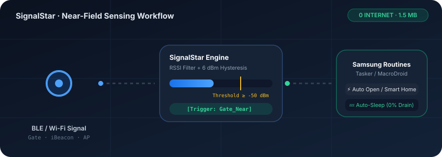
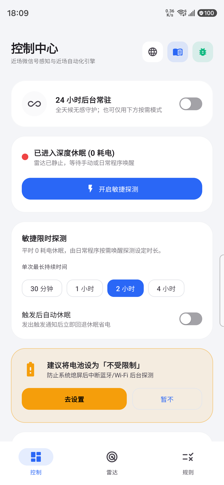
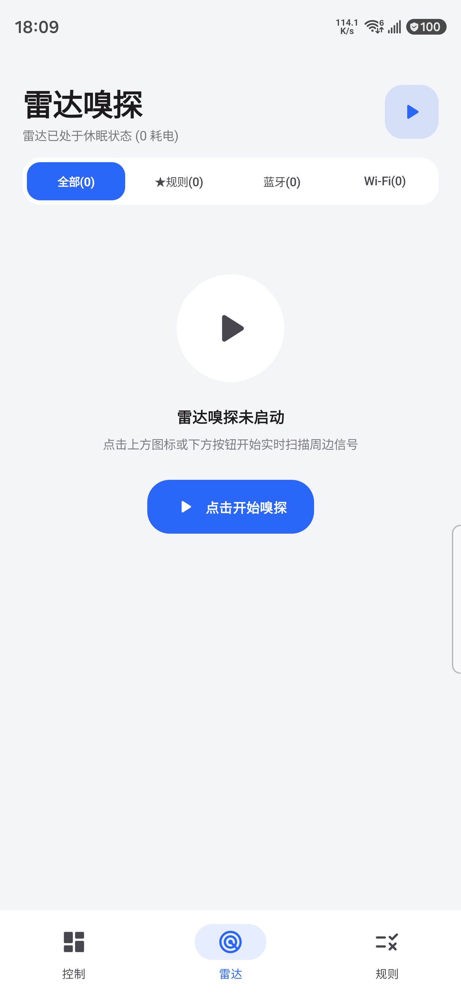
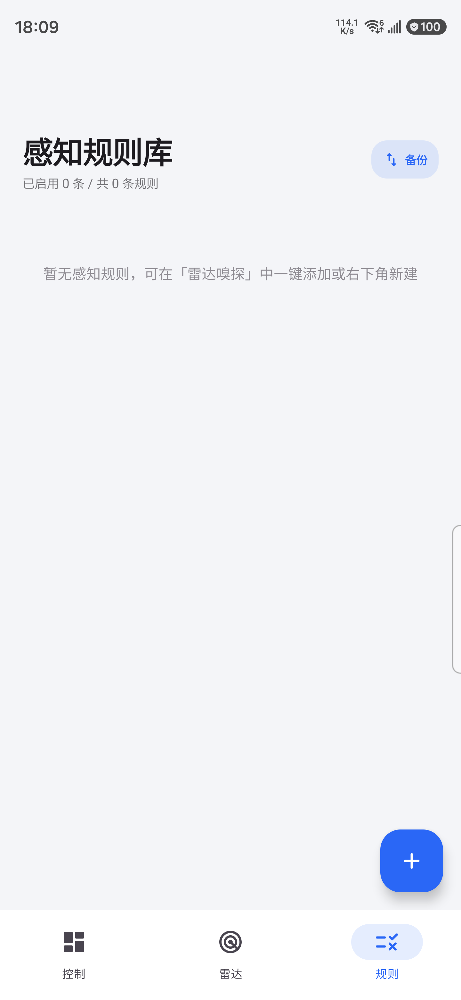

<div align="center">

# SignalStar (信号星)

**轻量级 · 零联网 · 超低功耗的近场蓝牙 (BLE) / Wi-Fi 微信号感知与系统自动化增强引擎**

[中文文档](./README.md) · [English Documentation](./README_EN.md)


-10B981?style=flat-square)
-10B981?style=flat-square)


<br/>



</div>

---

## 📱 界面预览

<table>
  <tr>
    <td align="center" width="33%">
      <br/>
      <sub><b>控制中心</b> · 三档功耗与状态总览</sub>
    </td>
    <td align="center" width="33%">
      <br/>
      <sub><b>雷达嗅探</b> · 蓝牙主力 + 按需 Wi-Fi</sub>
    </td>
    <td align="center" width="33%">
      <br/>
      <sub><b>感知规则库</b> · 实时测试与离线备份</sub>
    </td>
  </tr>
</table>

---

## 1. SignalStar 主要做什么？（核心功能详细介绍）

**SignalStar** 是一款专为手机系统自动化（如三星 **「模式与日常程序 (Modes & Routines)」**、Tasker、MacroDroid 等）打造的**外置近场信号雷达**。

### 核心功能模块一览
1. **主力能力：未配对低功耗蓝牙 (BLE) 近场感知（0 定位权限、0 定位蓝点）**
   - 突破系统蓝牙“必须已配对连接”的限制，直接监听周围 **BLE 广播包**：
     - **名称前缀匹配**：如小区单元门禁、智能车位锁、电梯呼梯信标等；
     - **物理 MAC 锁定**：精准绑定唯一设备，避免同名设备误触发；
     - **iBeacon & 厂商自定义广播**：支持 UUID / Major / Minor 与 Manufacturer Hex 数据匹配；
   - 在 Android 12+ 上通过 `neverForLocation` 与定位完全解耦：**纯蓝牙用户安装后无需授予任何定位权限**，后台监听也绝不点亮系统右上角定位指示点。

2. **进阶附加：Wi-Fi RSSI / BSSID 细粒度感知（按需授权）**
   - 无需连上 Wi-Fi 即可识别周边热点，或区分同一 Wi-Fi 名称下不同的 **Mesh 路由器节点（BSSID）**；
   - **严格按需启动**：默认后台完全关闭 Wi-Fi 扫描；只有当你主动创建/启用 Wi-Fi 规则，或进入雷达「Wi-Fi」页签时才按需申请定位权限，切走立即停止，杜绝无意义耗电与蓝点闪烁。

3. **抗抖动判定引擎（解决传统软件重复触发/卡死痛点）**
   - **RSSI 滑动平均滤波**：平滑人体遮挡导致的瞬时信号跳变；
   - **6 dBm 施密特滞后 + 5 秒硬防抖**：靠近进入感应区只触发 1 次（不会站在门前每秒连发几十次），离开信号区（信号衰减 ≥ 6 dBm 连续 2 包确认或设备离线超时）后自动重置，下次靠近立即再次触发；
   - **双向触发**：可选开启「离开信号范围时也通知」（`[Leave: ...]`），实现离家/离车位自动联动。

4. **系统自动化无缝桥接（Bridge Layer）**
   - **静默通知通道**：触发时发出无声、无震动、自动折叠且支持定时撤销（默认 15 秒）的特征通知（`[Trigger: 标签]` / `[Leave: 标签]`），零额外权限即可被三星日常程序拦截；
   - **全局标准广播**：同步发出 `com.clean.signalstar.ACTION_TRIGGER`，方便 Tasker / MacroDroid / 其他自动化工具毫秒级接收；
   - **无感后台快捷调度**：提供 `ActionDispatcherActivity` 与 App Shortcuts，外部日常程序在后台静默启停 SignalStar 时不会抢占前台打断当前界面。

5. **极简 One UI 工具箱**
   - **雷达实时嗅探器**：实时列表查看周边设备信号强度，点击一键提取特征并现场走动标定 RSSI 门限；
   - **双视图诊断台**：独立持久化保存「触发记录」（用户可读），与默认关闭（0 开销）的「运行调试日志」（开发者向）；
   - **离线备份迁移**：支持 `.json` 文件与剪贴板文本一键导入导出规则；
   - **中英双语 & 零联网关于页**：支持系统语言跟随或手动切换中/英文。

---

## 2. 为什么开发 SignalStar？

1. **系统自带蓝牙条件只认「已配对连接」**：无法感知未配对的小区门禁、iBeacon 或迎宾信标。
2. **系统自带 Wi-Fi 条件只认「连上/断开」**：无法按信号强弱（RSSI）或具体路由器 BSSID 判断，也无法不连网直接感应。
3. **GPS 地理围栏精度粗且费电**：50~200 米误差在楼道和地库极易漂移，无法做到“走到门前 1~2 米自动触发”。

---

## 3. 适用场景

| 场景 | 信号类型 | 典型玩法 |
| :--- | :--- | :--- |
| **小区/单元门禁靠近自动开门** | BLE 广播 | 靠近门禁 1~2 米（`RSSI ≥ -55 dBm`）自动触发日常程序打开开门 App 或执行快捷动作 |
| **桌面 / 床头 / 车载无感信标** | BLE / MAC 锁定 | 在工位或车内放置低成本 iBeacon，手机靠近自动切换工作/驾驶模式 |
| **无需连网的定点打卡/到站提醒** | Wi-Fi RSSI（敏捷模式） | 路过公司/车站热点无需连网，信号达标即触发打卡或弹乘车码 |
| **同 Wi-Fi 名下的 Mesh 房间/离家预判** | Wi-Fi BSSID + 离开触发 | 信号刚减弱到门口阈值就提前触发 `[Leave: ...]` 关灯切网 |

---

## 4. 体积、功耗与隐私安全

### 4.1 极致轻量：APK 仅约 1.6 MB
- 原生 Kotlin + Jetpack Compose 构建，开启 R8 压缩裁剪，无广告 SDK、无统计埋点、无冗余第三方库。

### 4.2 三档功耗管理（不瞎扫、不费电）
| 运行模式 | 工作机制 | 预估日耗电 | 适用人群 |
| :--- | :--- | :--- | :--- |
| **【模式 A】日常程序按需受控（最推荐）** | 关闭 24h 常驻 + 开启「触发后自动休眠」。平时 **0 耗电深度休眠**，由日常程序/车载蓝牙/地理围栏静默唤醒工作，触发后立即休眠 | **全天 < 0.3%** | 有外部自动化配合、追求极致省电的用户 |
| **【模式 B】24 小时低功耗常驻** | BLE 使用芯片硬件级 `SCAN_MODE_LOW_POWER` 并释放 `WakeLock`；无 Wi-Fi 规则时完全不开 Wi-Fi，有 Wi-Fi 规则时熄屏仅靠系统广播被动搭便车 | **纯 BLE 约 0.8%~1.5% / 天** | 懒得配外部唤醒、希望全天候随时走近即触发 |
| **【模式 C】限时敏捷探测** | 手动开启或设定 `30m / 1h / 2h / 4h` 倒计时，全速响应后自动休眠 | **约 0.2% / 小时** | 临时外出、进出地库或短时高敏扫 Wi-Fi |

### 4.3 零联网隐私保障 & 按需权限
- **物理级零联网**：`AndroidManifest.xml` 中**彻底移除 `INTERNET` 权限**，从系统底层保证绝不上传任何设备或位置信息。
- **权限最小化**：
  - Android 12+ 首次启动**只申请蓝牙与通知权限**；
  - `ACCESS_FINE_LOCATION` / `ACCESS_BACKGROUND_LOCATION` **仅在用户主动添加/启用 Wi-Fi 规则或切入雷达「Wi-Fi」页签时按需申请**；
  - Android 系统机制决定了调用 Wi-Fi 扫描/读取接口会触发定位指示点，若只用蓝牙规则可全程不授予定位权限（0 蓝点）。

---

## 5. 详细使用说明

### 第一步：基础授权
1. 安装 APK 后打开，在 Android 12+ 设备上仅需授予**附近设备（蓝牙）**与**通知**权限即可使用全部蓝牙功能。
2. 如需 24h 稳定守护，按首页提示将电池策略设为**「无限制 / 未受限」**。

### 第二步：雷达嗅探与建规则
1. 打开**「雷达」**标签页扫描周边设备（若需要找 Wi-Fi 热点，点击顶部分段里的**「Wi-Fi」**并授予定位权限即可，切出该页签后会自动停止 Wi-Fi 扫描）。
2. 点击目标设备一键**「设为规则」**：在现场拿着手机走近/走远观察**实时 dBm**，点击「设为当前-2」即可完成精准门限标定。

### 第三步：对接三星「模式与日常程序」或 Tasker / MacroDroid
- **通知拦截联动（推荐）**：在三星日常程序中设置 `如果：收到通知 -> 应用: SignalStar -> 包含关键字: [Trigger: 你的标签]`，即可触发任何原生动作。
- **外部控制广播**：
  - 开启敏捷模式：`com.clean.signalstar.ACTION_START_AGILE`（可选 Int Extra：`extra_duration_minutes`）
  - 开启 24h 常驻：`com.clean.signalstar.ACTION_START_24H`
  - 停止并休眠：`com.clean.signalstar.ACTION_STOP`
- **触发接收广播**：`com.clean.signalstar.ACTION_TRIGGER`（Extras：`extra_rule_id`、`extra_rule_name`、`extra_trigger_tag`、`extra_rssi`、`extra_signal_type`）。

---

## 6. 本地编译

```bash
git clone https://github.com/Healer-s/SignalStar.git
cd SignalStar
./gradlew assembleRelease
```

生成的 APK 位于 `app/build/outputs/apk/release/app-release.apk`。

---

## 7. 开源协议与引用声明 (License & Attribution)

本项目基于 **[GNU General Public License v3.0 (GPL-3.0)](./LICENSE)** 完全开源，并附带 [NOTICE](./NOTICE) 署名声明。

**使用或二次开发须遵守以下条件**：
1. 任何对本项目源码的修改、再分发或编译发布的衍生 APK，均**必须以 GPL-3.0 协议保持完全开源**，不可闭源套壳分发；
2. 必须在衍生项目的文档、`NOTICE` 及应用「关于」界面中保留原作者版权与出处声明：

```text
Based on SignalStar by Healer-s
Repository: https://github.com/Healer-s/SignalStar
License: GPL-3.0
```
