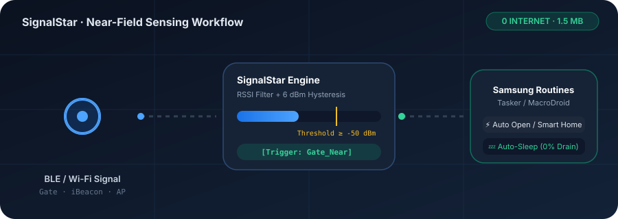
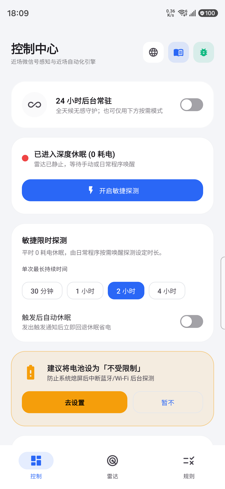
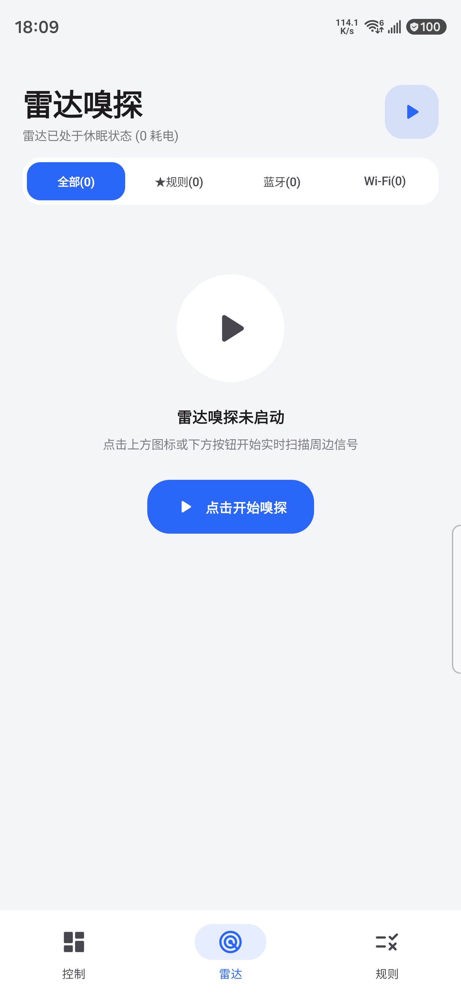
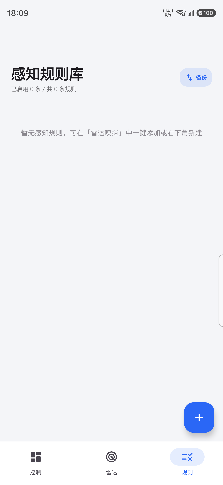

<div align="center">

# SignalStar

**Lightweight · Zero-Network · Ultra-Low-Power Near-Field BLE & Wi-Fi RSSI Sensing Engine**

[中文文档](./README.md) · [English Documentation](./README_EN.md)


-10B981?style=flat-square)
-10B981?style=flat-square)


<br/>



</div>

---

## 📱 Screenshots

<table>
  <tr>
    <td align="center" width="33%">
      <br/>
      <sub><b>Control Center</b> · Power Modes &amp; Status</sub>
    </td>
    <td align="center" width="33%">
      <br/>
      <sub><b>Radar Sniffer</b> · BLE-First + On-Demand Wi-Fi</sub>
    </td>
    <td align="center" width="33%">
      <br/>
      <sub><b>Sensing Rules</b> · Live Testing &amp; Backup</sub>
    </td>
  </tr>
</table>

---

## 1. What Does SignalStar Do? (Feature Overview)

**SignalStar** serves as an **external near-field signal radar** for Android automation tools such as **Samsung Modes & Routines**, **Tasker**, and **MacroDroid**.

### Core Capabilities
1. **Primary Engine: Unpaired BLE Advertisement Sensing (Zero Location Permission / Zero Blue Dot)**
   - Detects **unpaired BLE advertisements** that built-in Bluetooth triggers cannot see (access gates, parking locks, iBeacons, welcome beacons):
     - **Name Prefix**, **Exact MAC Lock**, **iBeacon (UUID / Major / Minor)**, and **Manufacturer Hex Data** matching;
   - Uses `neverForLocation` on Android 12+: **Bluetooth-only users are never prompted for Location permission on launch**, and background BLE monitoring never triggers Android's location indicator dot.

2. **Optional Add-On: Wi-Fi RSSI & BSSID Sensing (Strictly On-Demand)**
   - Triggers by RSSI threshold or specific router **BSSID** (distinguishing Mesh nodes under the same SSID) without needing to connect;
   - **Zero unnecessary scanning**: Background Wi-Fi scanning stays **OFF by default** unless an active Wi-Fi rule is enabled. Location permission is only requested when switching to the Radar **Wi-Fi** tab or adding/enabling a Wi-Fi rule.

3. **Anti-Jitter Detection Engine**
   - **Moving Average RSSI Filter** smooths body-blocking signal drops;
   - **6 dBm Schmitt Hysteresis + 5s Hard Debounce**: Triggers once upon entering range, stays silent while remaining inside, and resets automatically after moving away (2 weak packets or offline timeout);
   - **Bidirectional Triggers**: Optional **Notify on Leave** (`[Leave: ...]`) for exit automations.

4. **Seamless Automation Bridge**
   - **Silent Notification Channel**: Posts quiet, auto-dismissing notifications (`[Trigger: tag]` / `[Leave: tag]`) intercepted directly by Samsung Modes & Routines;
   - **Global Broadcast**: Emits `com.clean.signalstar.ACTION_TRIGGER` for Tasker, MacroDroid, and cross-brand automation apps;
   - **Invisible Shortcut Dispatcher**: `ActionDispatcherActivity` & App Shortcuts let Routines start/stop scanning silently without disturbing foreground apps.

5. **Clean One UI Toolkit**
   - Live **Radar Sniffer** with one-tap rule creation and real-time dBm threshold calibration;
   - Dual-tab **Triggers & Logs** (persistent human-readable trigger history + opt-in developer debug logs);
   - Offline `.json` file & clipboard rule backup, EN/ZH localization, and a zero-network About & Support card.

---

## 2. Why SignalStar?

1. **System Bluetooth triggers only see *paired & connected* devices** — blind to unpaired BLE access gates and iBeacons.
2. **System Wi-Fi triggers only see *connected / disconnected* states** — blind to RSSI distance thresholds and individual Mesh BSSIDs.
3. **GPS geofencing is coarse (50–200 m) and drifts indoors**, making 1–2 meter door triggers impossible.

---

## 3. Best Use Cases

| Use Case | Signal Type | How It Works |
| :--- | :--- | :--- |
| **Hands-Free Gate / Door Access** | Unpaired BLE | Approach within 1–2 m (`RSSI >= -55 dBm`) to trigger Samsung Routines & open your access app |
| **Desk / Bedside / Car Beacon** | BLE / MAC Lock | Place a cheap iBeacon on your desk or in your car to switch modes automatically |
| **No-Connect Proximity Triggers** | Wi-Fi RSSI (Agile Mode) | Trigger check-ins or transit cards near public hotspots without connecting |
| **Mesh Room / Pre-Disconnect Leave** | Wi-Fi BSSID + Leave | Trigger `[Leave: ...]` lights/network switches as signal drops near the doorway |

---

## 4. APK Size, Battery & Zero-Network Privacy

### 4.1 Ultra-Lightweight: ~1.6 MB APK
- Built with native Kotlin + Jetpack Compose and R8 shrinking — zero ad SDKs, zero analytics, zero bloat.

### 4.2 Three Power Tiers
| Mode | How It Works | Est. Battery Drain | Best For |
| :--- | :--- | :--- | :--- |
| **Mode A: Routine On-Demand (Recommended)** | Disable 24h Guard + enable **Auto-sleep after trigger**. Sleeps at **0% drain** until woken by Routines/Shortcuts/Broadcasts | **< 0.3% / day** | Users pairing SignalStar with coarse Routines / Tasker triggers |
| **Mode B: 24h Low-Power Guard** | BLE uses `SCAN_MODE_LOW_POWER` with no CPU `WakeLock`; Wi-Fi stays OFF unless enabled in rules (passive system scan broadcast only) | **~0.8% – 1.5% / day (BLE-only)** | Zero-setup always-on proximity detection |
| **Mode C: Agile Timed Scan** | Manual timer (`30m / 1h / 2h / 4h`) that returns to Deep Sleep on timeout or trigger | **~0.2% / hour** | Short trips, garages, or high-sensitivity Wi-Fi sensing |

### 4.3 Zero-Network Privacy & Minimal Permissions
- **No `INTERNET` Permission**: Completely stripped from `AndroidManifest.xml` — physically incapable of uploading any device or location data.
- **Lazy Location Permission**: Android 12+ requests only Bluetooth + Notifications on first launch; Location is requested strictly when creating/enabling a Wi-Fi rule or opening the Radar **Wi-Fi** tab.

---

## 5. Quick Start

1. Install the APK and grant **Nearby Devices (Bluetooth)** and **Notifications** permissions (set Battery to **Unrestricted** if using 24h Guard).
2. Open **Radar** to sniff nearby BLE devices (tap the **Wi-Fi** tab only if you need Wi-Fi rules), tap a device, and calibrate your RSSI threshold live.
3. In **Samsung Modes & Routines**:
   - **If**: `Notification received` -> App: `SignalStar` -> Keyword: `[Trigger: your_tag]`
   - **Control Broadcasts**: `com.clean.signalstar.ACTION_START_AGILE`, `ACTION_START_24H`, `ACTION_STOP`
   - **Trigger Broadcast**: `com.clean.signalstar.ACTION_TRIGGER` (`extra_rule_id`, `extra_rule_name`, `extra_trigger_tag`, `extra_rssi`, `extra_signal_type`)

---

## 6. Build from Source

```bash
git clone https://github.com/Healer-s/SignalStar.git
cd SignalStar
./gradlew assembleRelease
```

The release APK is generated at `app/build/outputs/apk/release/app-release.apk`.

---

## 7. License & Attribution

This project is open-sourced under the **[GNU General Public License v3.0 (GPL-3.0)](./LICENSE)** with an explicit [NOTICE](./NOTICE).

Any redistribution, modification, or derivative APK **must remain open-source under GPL-3.0**, retain the original copyright notice, and credit the author:

```text
Based on SignalStar by Healer-s
Repository: https://github.com/Healer-s/SignalStar
License: GPL-3.0
```
